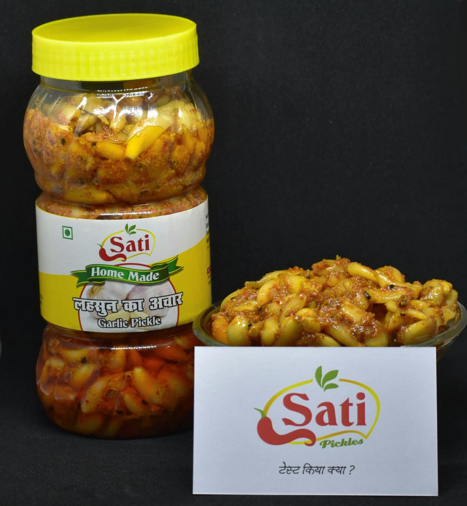
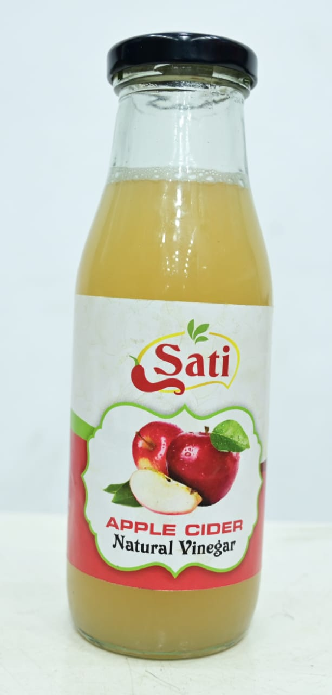

<div align="center">

# 🫙 Sati Aachar (सती अचार)
### *Authentic Homemade Indian Pickles & Natural Vinegar Store*

[](https://react.dev/)
[](https://vitejs.dev/)
[](https://tailwindcss.com/)
[](LICENSE)
[](https://zainab-555.github.io/Sati-Aachar/)

<p align="center">
  <b>"स्वाद नानी के हाथों का • टेस्ट किया क्या?"</b><br/>
  100% Handcrafted Indian Pickles made with Cold-Pressed Mustard Oil, Sun-Cured Spices, and Heritage Recipes.
</p>

[✨ Live Demo](https://zainab-555.github.io/Sati-Aachar/) • [📦 View Products](#-signature-products) • [🚀 Quick Start](#-getting-started) • [🌟 Key Features](#-key-features)

---

</div>

## 📖 About The Brand

**Sati Aachar** is a modern, responsive quick-commerce grocery web application built for an artisanal Indian pickle brand. Unlike commercial pickles made with synthetic acids and chemical preservatives, Sati Aachar honors India's 3,000-year-old culinary tradition:
- ☀️ **Sun-Fermented in Ceramic Martabans** for 21 to 40 days
- 🌿 **100% Pure Cold-Pressed Kacchi Ghani Mustard Oil**
- 🌶️ **Hand-Roasted and Stone-Pounded Indian Spices**
- 🫙 **Sterile Leak-Proof Food Grade Packaging**

---

## 🌟 Key Features

### 🛒 Quick-Commerce E-Commerce UI/UX
- **Interactive Sticky Header**: Brand logo seal, search bar with autocomplete filtering, wishlist counter, and animated cart drawer.
- **Hero Banner Showcase**: Multi-slide dynamic promotional carousel featuring authentic Sati jars with instant CTAs.
- **Instant Category Filtering**: 1-click filtering across Mango, Chili, Garlic, Mixed, Sprouted Fenugreek, and Natural Vinegar.
- **Marketplace Product Cards**:
  - Live **Jar Size Selector (250g / 500g / 1kg)** that dynamically recalculates prices and discount savings.
  - Heat Meter gauge (`🌶️ Level 1/4 to 4/4`).
  - Interactive "Add to Cart" button that morphs into a live quantity stepper `[- 1 +]`.
- **Slide-Over Shopping Cart Drawer**:
  - Free Shipping Progress Meter (`₹499 Threshold`).
  - Promo coupon engine supporting **`SATI10`** for an instant 10% discount.
  - Subtotal, delivery calculation, and grand total breakdown.
- **Product Quick-View Modal**: Detailed popover highlighting shelf life, ingredients, and medicinal benefits.
- **2-Minute Instant Checkout Modal**: Supports UPI (GPay/PhonePe), Cash on Delivery (COD), and cards with order celebration feedback.
- **Mobile-First Experience**: Optimized touch navigation and clean responsive design.

---

## 🍯 Signature Products

| Product | Name (Hindi) | Jar Sizes | Price | Highlights |
| :--- | :--- | :--- | :--- | :--- |
|  | **आम का अचार** (Mango) | 250g, 500g, 1kg | ₹120 - ₹440 | Traditional Ramkela mangoes in pure mustard oil |
|  | **लाल मिर्च भरवा** (Stuffed Chili) | 250g, 500g, 1kg | ₹140 - ₹520 | Banarasi stuffed red peppers with amchur & spices |
|  | **लहसुन का अचार** (Garlic) | 250g, 500g, 1kg | ₹150 - ₹560 | Digestive immunity booster with strong heeng |
|  | **मिश्रित अचार** (Mix Vegetable) | 250g, 500g, 1kg | ₹120 - ₹430 | Crunchy seasonal mix of carrot, cauliflower & mango |
|  | **अंकुरित मेथी** (Fenugreek) | 250g, 500g, 1kg | ₹160 - ₹590 | Ayurvedic sprouted methi for gut health & joints |
|  | **Apple Cider Vinegar** | 500ml, 1 Litre | ₹299 - ₹549 | 100% Raw Himalayan apple juice with The Mother |

---

## 🛠️ Tech Stack

- **Frontend**: [React 18](https://react.dev/)
- **Bundler / Dev Server**: [Vite 6](https://vitejs.dev/)
- **Styling**: [Tailwind CSS 3](https://tailwindcss.com/)
- **Icons**: Custom Lightweight Scalable React SVGs
- **Typography**: Google Fonts (*Playfair Display* & *Plus Jakarta Sans*)
- **Deployment**: GitHub Pages / Vercel / Netlify

---

## 📁 Project Structure

```bash
Sati-Aachar/
├── .github/
│   └── workflows/
│       └── deploy.yml        # Automated GitHub Pages CI/CD
├── images/                   # High-res authentic product photography
│   ├── 1.jpeg                # Apple Cider Vinegar
│   ├── 2.jpeg                # Mix Vegetable Pickle
│   ├── 3.jpeg                # Mango Pickle
│   ├── 4.jpeg                # Stuffed Red Chili Pickle
│   ├── 5.jpeg                # Sprouted Fenugreek Pickle
│   └── 8jpeg.jpeg            # Garlic Pickle
├── src/
│   ├── components/
│   │   ├── CartDrawer.jsx    # Slide-over cart with coupon & shipping bar
│   │   ├── CheckoutModal.jsx # Quick checkout with address & payment
│   │   ├── Footer.jsx        # Footer with brand certifications
│   │   ├── Header.jsx        # Sticky navigation & search bar
│   │   ├── Hero.jsx          # Promotional banner carousel
│   │   ├── Icons.jsx         # Custom SVG icon set
│   │   ├── ProductCard.jsx   # Marketplace product card
│   │   ├── ProductModal.jsx  # Quick view modal dialog
│   │   ├── Reviews.jsx       # Verified customer testimonials
│   │   └── WhyChooseUs.jsx   # 4 heritage pillars
│   ├── data/
│   │   └── products.js       # Central product catalog & variants
│   ├── App.jsx               # Main application container
│   ├── index.css             # Tailwind CSS entry & custom animations
│   └── main.jsx              # React root entry point
├── .gitignore
├── index.html                # HTML entry point (Translation-proof)
├── package.json
├── preview.html              # 1-Click standalone offline preview
├── tailwind.config.js
└── vite.config.js
```

---

## 🚀 Getting Started

### 1. Clone the repository
```bash
git clone https://github.com/zainab-555/Sati-Aachar.git
cd Sati-Aachar
```

### 2. Install dependencies
```bash
npm install
```

### 3. Start development server
```bash
npm run dev
```
Open **`http://localhost:3000`** in your browser.

### 4. Build for production
```bash
npm run build
```

---

## 🌐 Deploy to GitHub Pages

1. Push your repository to GitHub:
   ```bash
   git add .
   git commit -m "feat: Sati Aachar React e-commerce store"
   git branch -M main
   git remote add origin https://github.com/zainab-555/Sati-Aachar.git
   git push -u origin main
   ```
2. Go to your repository on GitHub:
   - Navigate to **Settings** ➔ **Pages**
   - Under **Build and deployment** ➔ **Source**, select **GitHub Actions**
3. The included GitHub Action (`.github/workflows/deploy.yml`) will automatically build and publish your site!

---

<div align="center">
  <sub>Made with ❤️ by <a href="https://github.com/zainab-555">Zainab Tanweer</a> for Sati Aachar.</sub>
</div>
